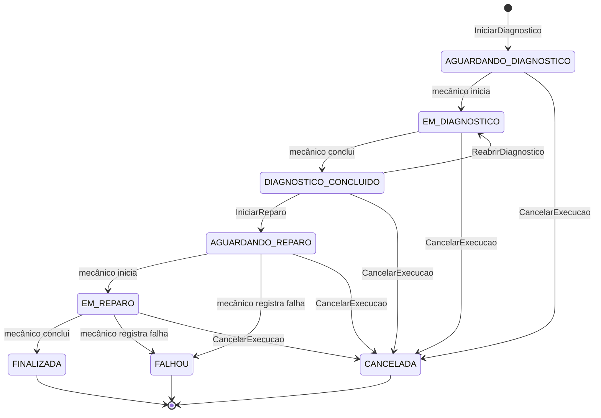

# oficina-execution-service

Serviço de execução do sistema de gestão de oficina mecânica, desenvolvido no Tech Challenge da PosTech FIAP (Arquitetura de Software, Fase 4). Gerencia a fila de execução das ordens de serviço, registra o diagnóstico e o reparo feitos pelos mecânicos e comunica ao OS Service a finalização ou a falha da execução.

[](https://sonarcloud.io/summary/new_code?id=Guilherme-Fumagali_oficina-execution-service)
[](https://sonarcloud.io/summary/new_code?id=Guilherme-Fumagali_oficina-execution-service)
[](https://sonarcloud.io/summary/new_code?id=Guilherme-Fumagali_oficina-execution-service)

## Repositórios do projeto

| Repositório | Conteúdo |
|---|---|
| [tech-challenge-1](https://github.com/Guilherme-Fumagali/tech-challenge-1) | OS Service: clientes, veículos, catálogo, estoque, ordens de serviço e orquestração da saga |
| [oficina-billing-service](https://github.com/Guilherme-Fumagali/oficina-billing-service) | Billing Service: orçamento, aprovação e pagamento |
| **oficina-execution-service** | Execution Service: fila de execução, diagnóstico e reparo (este repositório) |
| [oficina-auth-lambda](https://github.com/Guilherme-Fumagali/oficina-auth-lambda) | Autenticação por CPF com segundo fator |
| [oficina-infra-k8s](https://github.com/Guilherme-Fumagali/oficina-infra-k8s) | Plataforma: rede, EKS, ECR, API Gateway, Pod Identity e New Relic |

## Links

| Artefato | Local |
|---|---|
| Contrato OpenAPI | [`docs/openapi.json`](docs/openapi.json), visualizável no [Redoc](https://redocly.github.io/redoc/?url=https://raw.githubusercontent.com/Guilherme-Fumagali/oficina-execution-service/develop/docs/openapi.json) |
| Contrato AsyncAPI 2.6 | [`docs/asyncapi.yaml`](docs/asyncapi.yaml), visualizável no [AsyncAPI Studio](https://studio.asyncapi.com/?url=https://raw.githubusercontent.com/Guilherme-Fumagali/oficina-execution-service/develop/docs/asyncapi.yaml) |
| Coleção Postman | [`docs/postman/execution.postman_collection.json`](docs/postman/execution.postman_collection.json) |
| Swagger UI | `http://localhost:8082/swagger-ui.html` na execução local |
| Decisões de arquitetura da fase | [ADR-016 a ADR-025](https://github.com/Guilherme-Fumagali/tech-challenge-1/blob/develop/docs/tech-challenge-4/adrs/README.md), em `docs/tech-challenge-4` do repositório tech-challenge-1 |
| Vídeo de demonstração | a publicar |

## Arquitetura

O serviço roda no EKS, no namespace `oficina`, atrás do API Gateway. As rotas `/api/execucoes` e `/api/execucoes/{proxy+}` passam pelo Lambda authorizer e chegam ao serviço pelo listener 8082 do NLB e pelo NodePort 30082. O serviço valida novamente o JWT, persiste no Amazon DocumentDB e troca mensagens com o OS Service pelo Amazon SQS.

```mermaid
flowchart LR
    os[OS Service<br/>orquestrador da saga]
    mecanico[Mecânico / cliente]
    subgraph execution[Execution Service]
        api[ExecucaoController<br/>REST + JWT]
        consumidor[ConsumidorComandosExecucao<br/>@SqsListener]
        casos[Casos de uso<br/>UnidadeDeTrabalho]
        dominio[Execucao<br/>agregado]
        repo[ExecucaoRepositoryMongo]
        outbox[PublicadorOutbox]
        relay[RelayOutbox<br/>@Scheduled]
    end
    comandos[(SQS<br/>execution-comandos<br/>+ DLQ)]
    eventos[(SQS<br/>os-eventos)]
    docdb[(DocumentDB 5.0<br/>execucoes · outbox ·<br/>mensagensProcessadas)]
    nr[New Relic]

    mecanico -->|HTTPS| api
    os -->|comandos| comandos --> consumidor
    api --> casos
    consumidor --> casos
    casos --> dominio
    casos --> repo --> docdb
    casos --> outbox --> docdb
    relay -->|findAndModify| docdb
    relay -->|eventos| eventos --> os
    execution -. métricas, logs e traces .-> nr
```

O código segue Clean Architecture, com o mesmo arranjo do OS Service:

```
src/main/java/com/oficina/execution/
├── domain/          agregado Execucao, objetos de valor, exceções e porta do repositório (sem framework)
├── application/     casos de uso, portas (UnidadeDeTrabalho, PublicadorEventos, RegistroMensagensProcessadas,
│                    MetricasExecucao), modelo dos comandos recebidos e dos eventos de integração
└── infrastructure/  Spring Boot, MongoDB, SQS, REST, segurança JWT, métricas e configuração
```

Os casos de uso são classes simples, instanciadas em `UseCaseConfig`. Todo caso de uso que escreve executa leitura, validação, gravação do documento e registro no outbox dentro de uma `UnidadeDeTrabalho`, implementada por `TransacaoMongo` sobre o `MongoTransactionManager`.

## Papel na saga

A saga da ordem de serviço é orquestrada pelo OS Service (ADR-017). O Execution Service é participante: não conhece o estado da saga, responde aos comandos do orquestrador e publica os fatos registrados pelos mecânicos.

| Passo da saga | Comando recebido | Efeito no Execution | Mensagem publicada |
|---|---|---|---|
| Abertura da OS | `IniciarDiagnostico` | cria a execução em `AGUARDANDO_DIAGNOSTICO` | `ExecucaoEnfileirada{DIAGNOSTICO}` |
| Diagnóstico | mecânico (REST) | `EM_DIAGNOSTICO` e depois `DIAGNOSTICO_CONCLUIDO` | `DiagnosticoIniciado`, `DiagnosticoConcluido` |
| Diagnóstico sem itens | `ReabrirDiagnostico` | volta para `EM_DIAGNOSTICO`, com apontamento automático | nenhuma |
| Pagamento aprovado | `IniciarReparo` | `AGUARDANDO_REPARO`, com os itens do reparo | `ExecucaoEnfileirada{REPARO}` |
| Reparo | mecânico (REST) | `EM_REPARO` e depois `FINALIZADA` | `ReparoIniciado`, `ExecucaoFinalizada` |
| Falha na execução | mecânico (REST) | `FALHOU`, com motivo | `ExecucaoFalhou` (o OS inicia a compensação `FALHA_EXECUCAO`) |
| Compensação (reprovação, rejeição, pagamento recusado) | `CancelarExecucao` | `CANCELADA` | `ExecucaoCancelada` |

O enfileiramento do diagnóstico é desfeito por `CancelarExecucao`. Falha técnica é repetida pela fila; falha de negócio no reparo gera `ExecucaoFalhou`, e o OS Service inicia as compensações.



A tabela de transições fica em `StatusExecucao`, e as operações do agregado `Execucao` conferem a origem esperada antes de mudar o status (iniciar o diagnóstico exige `AGUARDANDO_DIAGNOSTICO`; reabrir exige `DIAGNOSTICO_CONCLUIDO`). Apontamentos e alteração de prioridade são aceitos em qualquer status não terminal.

## Mensagens

O contrato completo está em [`docs/asyncapi.yaml`](docs/asyncapi.yaml), derivado da SPEC-08 do plano da fase. Toda mensagem é um envelope JSON com `mensagemId`, `tipo`, `versao`, `sagaId`, `osId`, `causadaPor`, `origem`, `ocorridoEm` e `dados`, e carrega os atributos SQS `tipo` e `versao`.

| Fila | Direção | Tipos |
|---|---|---|
| `oficina-<env>-execution-comandos` (DLQ `-dlq`, 5 recebimentos) | consumida | `IniciarDiagnostico`, `ReabrirDiagnostico`, `IniciarReparo`, `CancelarExecucao` |
| `oficina-<env>-os-eventos` | publicada | `ExecucaoEnfileirada`, `DiagnosticoIniciado`, `DiagnosticoConcluido`, `ReparoIniciado`, `ExecucaoFinalizada`, `ExecucaoFalhou`, `ExecucaoCancelada`, `ComandoRejeitado` |

**Publicação (Transactional Outbox).** Nenhum caso de uso chama a SQS. O evento é gravado na coleção `outbox` na mesma transação do documento da execução, com os cabeçalhos de rastreamento do New Relic. O `RelayOutbox`, a cada 500 ms, reivindica mensagens com `findAndModify` (`status: PENDENTE` e `reservadaAte` anterior ao início do ciclo, reserva de 30 s), envia pelo `SqsTemplate` e marca `PUBLICADA`. Em erro, incrementa `tentativas`, grava `ultimoErro` e libera a reserva para o ciclo seguinte. A reivindicação atômica permite várias réplicas do serviço sem envio concorrente da mesma mensagem.

**Consumo idempotente.** O listener (`ON_SUCCESS`, até 5 mensagens simultâneas) processa cada comando numa unidade de trabalho que consulta e grava a inbox `mensagensProcessadas` (`_id = mensagemId`, TTL de 14 dias) junto com o efeito. Duplicata exata é descartada. Os comandos também são idempotentes pela chave de negócio `osId`:

| Comando | Situação | Resposta |
|---|---|---|
| `IniciarDiagnostico` | execução já existe (em qualquer status) | `ExecucaoEnfileirada{DIAGNOSTICO}` de novo, com o instante original |
| `IniciarReparo` | reparo já enfileirado (`AGUARDANDO_REPARO`, `EM_REPARO`, `FINALIZADA`, `FALHOU`) | `ExecucaoEnfileirada{REPARO}` de novo, com o instante original |
| `ReabrirDiagnostico` | execução já em `EM_DIAGNOSTICO` | nenhuma (ignorado) |
| `CancelarExecucao` | execução já cancelada | `ExecucaoCancelada` de novo, com motivo e instante originais |

**Rejeição e falha técnica.** Comando que não faz sentido no estado da execução recebe `ComandoRejeitado` com `codigo` `EXECUCAO_INEXISTENTE`, `ESTADO_INVALIDO`, `DADOS_INVALIDOS` ou `COMANDO_DESCONHECIDO`, e a mensagem é reconhecida. Falha técnica (banco indisponível, conflito de escrita) e corpo que não é um envelope válido lançam exceção: a mensagem volta após a visibilidade de 30 s e segue para a DLQ após 5 recebimentos.

**Rastreamento.** O consumo e o envio de cada mensagem são transações `@Trace(dispatcher = true)` nomeadas `Mensageria/Consumo/<tipo>` e `Mensageria/Relay/<tipo>`, que aceitam os cabeçalhos `newrelic`, `traceparent` e `tracestate`. As transações recebem os atributos `os.id`, `saga.id` e `mensagem.tipo`, e os logs recebem `os.id`, `saga.id` e `mensagem.id` no MDC.

## Banco e justificativa

O Execution Service usa **MongoDB**, provisionado na AWS como **Amazon DocumentDB 5.0**, compatível com a API do MongoDB (ADR-019). Os outros serviços usam PostgreSQL (OS e Billing) e DynamoDB (desafios do segundo fator).

**Por que documentos.** A execução é um agregado com listas que pertencem só a ela: etapas, apontamentos do mecânico, histórico de status e itens de reparo. Essas listas crescem de forma desigual (uma reabertura de diagnóstico cria nova etapa; campos como `motivoFalha` só existem em alguns status) e são sempre lidas e gravadas junto com a execução. A aula 2 de Data Engineering apresenta os bancos de documentos para dados semiestruturados que "variam em sua estrutura ao longo do tempo" e observa que, em vez de normalizar os dados em várias tabelas, é comum incorporar os relacionamentos diretamente nos documentos. Com isso:

- cada caso de uso lê e grava um único documento por `osId` (`_id` do documento), sem junções;
- o lock otimista fica no próprio documento (`versao`, com `@Version`);
- a fila de execução é atendida por um índice composto `{status: 1, prioridade: -1, enfileiradaEm: 1}`;
- a gravação do documento é atômica por si só, e o par documento + outbox + inbox usa transação multi-documento, recurso que a mesma aula indica no MongoDB a partir da versão 4.0 e que o DocumentDB oferece.

**Por que DocumentDB.** A aula 2 cita o DocumentDB entre os bancos de documentos, e a aula 6 de Data Engineering o apresenta como serviço gerenciado da AWS compatível com MongoDB, dentro do modelo de banco como serviço (DBaaS), com backup, manutenção e criptografia em repouso e em trânsito a cargo do provedor. O cluster fica nas subnets privadas da VPC do projeto, com o mesmo modelo de security group, subnet group, backup e TLS obrigatório usado no RDS dos outros serviços.

| Alternativa | Motivo do descarte |
|---|---|
| Redis | banco chave-valor em memória voltado a cache e sessões, com persistência em disco opcional (Data Engineering, aula 3); não serve como registro de negócio da execução |
| Cassandra | banco colunar pensado para distribuição em vários nós, com custos de aquisição, configuração e manutenção do cluster e necessidade de pessoal qualificado para mantê-lo (aula 4); desproporcional ao volume de uma rede de oficinas |
| Neo4j | o centro do problema não são relacionamentos entre entidades; alta disponibilidade e cluster só na edição Enterprise (aula 5). Fica como possível modelo de leitura em grafo |
| DynamoDB | as aulas o apresentam apenas como serviço gerenciado (aula 6), sem conteúdo de modelagem; a fila filtrada por status e etapa e ordenada por prioridade e tempo dependeria de índices secundários desenhados em torno das chaves |
| MongoDB Atlas | DBaaS do próprio MongoDB citado na aula 2, mas fora da VPC e da conta AWS do projeto, com outra cobrança e acesso pela internet ou por peering |
| MongoDB em StatefulSet no EKS | exigiria o driver EBS CSI, volumes persistentes, backup e atualização operados pela equipe, sem ganho em relação ao serviço gerenciado |

### Compatibilidade com o DocumentDB

| Cuidado | Implementação |
|---|---|
| O DocumentDB não cria coleção implicitamente dentro de transação, e a Boot 3 não cria índices automaticamente | `InicializadorMongo` (`ApplicationRunner`, fora de transação e idempotente) cria `execucoes`, `outbox` e `mensagensProcessadas` e os quatro índices na subida |
| A URI do DocumentDB usa `readPreference=secondaryPreferred`, e o driver recusa leitura não primária dentro de transação (`Read preference in a transaction must be primary`) | o `MongoTransactionManager` é criado com `TransactionOptions.readPreference(primary)`; os testes de integração usam a mesma opção na URI e falham sem esse ajuste |
| O DocumentDB não oferece escrita repetível | `retryWrites=false` na URI |
| TLS obrigatório (`tls=enabled` no parameter group) | o `Dockerfile` baixa o `global-bundle.pem` da AWS e gera `/opt/docdb/truststore.jks` a partir do `cacerts` da JRE mais os certificados do bundle (um alias por certificado); os overlays do Kubernetes apontam `javax.net.ssl.trustStore` para esse arquivo |
| API suportada | somente CRUD, `findAndModify`, contagem, índices compostos, índice TTL e transações |

A URI do DocumentDB é montada pelo pipeline a partir dos parâmetros `docdb-*` do SSM:

```
mongodb://<user>:<pass>@<host>:27017/execucao?tls=true&replicaSet=rs0&readPreference=secondaryPreferred&retryWrites=false
```

## Modelo do documento

Coleção `execucoes`, um documento por ordem de serviço. Identificadores são gravados como texto, datas como `Date` do BSON (mostradas abaixo em ISO-8601) e campos nulos não são gravados.

```json
{
  "_id": "c3a1d8a2-5e8f-4b3a-9d1c-2b7e6f4a9e10",
  "sagaId": "7f1c2e0a-1d5b-4c7e-8a51-3f0e2a9b6c44",
  "clienteId": "5b0e3c1a-7d2f-4e6a-9c8b-1a2d3e4f5a6b",
  "veiculo": { "placa": "BRA2E19", "marca": "Volkswagen", "modelo": "Gol", "anoFabricacao": 2019 },
  "status": "EM_REPARO",
  "etapaAtual": "REPARO",
  "prioridade": 2,
  "enfileiradaEm": "2026-10-31T13:10:00.000Z",
  "itensReparo": [
    { "tipo": "SERVICO", "descricao": "Troca de pastilhas", "quantidade": 1 },
    { "tipo": "PECA", "descricao": "Pastilha de freio dianteira", "quantidade": 2 }
  ],
  "etapas": [
    { "tipo": "DIAGNOSTICO", "mecanicoId": "6f1c4d2e-9a0b-4c3d-8e7f-1a2b3c4d5e6f",
      "inicio": "2026-10-30T14:20:00.000Z", "fim": "2026-10-30T15:05:00.000Z" },
    { "tipo": "REPARO", "mecanicoId": "6f1c4d2e-9a0b-4c3d-8e7f-1a2b3c4d5e6f",
      "inicio": "2026-10-31T13:30:00.000Z" }
  ],
  "apontamentos": [
    { "mecanicoId": "6f1c4d2e-9a0b-4c3d-8e7f-1a2b3c4d5e6f",
      "texto": "Disco dianteiro dentro da espessura mínima", "registradoEm": "2026-10-30T14:40:00.000Z" }
  ],
  "historicoStatus": [
    { "para": "AGUARDANDO_DIAGNOSTICO", "em": "2026-10-30T14:05:11.733Z" },
    { "de": "AGUARDANDO_DIAGNOSTICO", "para": "EM_DIAGNOSTICO", "em": "2026-10-30T14:20:00.000Z" },
    { "de": "EM_DIAGNOSTICO", "para": "DIAGNOSTICO_CONCLUIDO", "em": "2026-10-30T15:05:00.000Z" },
    { "de": "DIAGNOSTICO_CONCLUIDO", "para": "AGUARDANDO_REPARO", "em": "2026-10-31T13:10:00.000Z" },
    { "de": "AGUARDANDO_REPARO", "para": "EM_REPARO", "em": "2026-10-31T13:30:00.000Z" }
  ],
  "observacoesDiagnostico": "Pastilhas dianteiras no limite de desgaste",
  "versao": 6
}
```

| Coleção | Conteúdo | Índices |
|---|---|---|
| `execucoes` | agregado Execução | `idx_execucoes_fila {status: 1, prioridade: -1, enfileiradaEm: 1}`, `idx_execucoes_cliente {clienteId: 1}` |
| `outbox` | `_id = mensagemId`, `fila` (chave lógica `os-eventos`), `tipo`, `versao`, `osId`, `sagaId`, `payload` (envelope serializado), `cabecalhos`, `status` (`PENDENTE`/`PUBLICADA`), `criadaEm`, `reservadaAte`, `publicadaEm`, `tentativas`, `ultimoErro` | `idx_outbox_pendentes {status: 1, criadaEm: 1}` |
| `mensagensProcessadas` | inbox: `_id = mensagemId`, `tipo`, `processadaEm` | `idx_mensagens_processadas_ttl {processadaEm: 1}` com `expireAfterSeconds` de 14 dias |

## Tecnologias

| Área | Tecnologia |
|---|---|
| Linguagem e framework | Java 21, Spring Boot 3.4.7 |
| Persistência | MongoDB (Amazon DocumentDB 5.0 na AWS, `mongo:6.0.14` local e nos testes), Spring Data MongoDB, `MongoTransactionManager` |
| Mensageria | Amazon SQS, Spring Cloud AWS 3.3.1, LocalStack 3 |
| Segurança | Spring Security, JJWT 0.12.6 (validação de JWT HMAC emitido pelo Lambda de autenticação) |
| Documentação | SpringDoc OpenAPI 2.7.0, AsyncAPI 2.6 |
| Observabilidade | agente Java do New Relic 9.4.0 e `newrelic-api`, Micrometer com OTLP, logs estruturados ECS |
| Testes | JUnit 5, Mockito, AssertJ, Testcontainers 1.20.3 (MongoDB e LocalStack), Awaitility, JaCoCo |
| Build e implantação | Maven, Docker, GitHub Actions, Amazon ECR, Amazon EKS com Kustomize, Terraform |

## Execução local

Pré-requisitos: Docker e Docker Compose, com as portas `8082`, `27017` e `4566` livres.

```bash
cp .env.example .env
docker compose up --build
```

O compose sobe o `mongo:6.0.14` como replica set de um nó (`rs0`, iniciado pelo próprio healthcheck), o LocalStack 3 com as filas `oficina-local-execution-comandos` e `oficina-local-os-eventos` e as respectivas DLQs (script [`localstack/init/ready.d/criar-filas.sh`](localstack/init/ready.d/criar-filas.sh)) e a API no perfil `local`.

| Serviço | Endereço |
|---|---|
| API | `http://localhost:8082` |
| Swagger UI | `http://localhost:8082/swagger-ui.html` |
| MongoDB | `mongodb://localhost:27017/execucao?directConnection=true` |
| SQS (LocalStack) | `http://localhost:4566` |

Para criar uma execução sem o OS Service, publique o comando `IniciarDiagnostico` na fila (o exemplo completo do envelope está no AsyncAPI):

```bash
docker exec execution-localstack awslocal sqs send-message \
  --queue-url http://localhost:4566/000000000000/oficina-local-execution-comandos \
  --message-body '{"mensagemId":"0d6f6f0e-8b0a-4d39-9a4e-9c8a5f3a1b11","tipo":"IniciarDiagnostico","versao":1,"sagaId":"7f1c2e0a-1d5b-4c7e-8a51-3f0e2a9b6c44","osId":"c3a1d8a2-5e8f-4b3a-9d1c-2b7e6f4a9e10","causadaPor":null,"origem":"os-service","ocorridoEm":"2026-10-30T14:05:11.482Z","dados":{"clienteId":"5b0e3c1a-7d2f-4e6a-9c8b-1a2d3e4f5a6b","veiculo":{"placa":"BRA2E19","marca":"Volkswagen","modelo":"Gol","anoFabricacao":2019}}}'
docker exec execution-localstack awslocal sqs receive-message \
  --queue-url http://localhost:4566/000000000000/oficina-local-os-eventos
```

Sem Docker para a API, com o MongoDB e o LocalStack do compose em execução:

```bash
SPRING_PROFILES_ACTIVE=local ./mvnw spring-boot:run
```

### Variáveis de ambiente

| Variável | Padrão | Descrição |
|---|---|---|
| `MONGODB_URI` | `mongodb://localhost:27017/execucao?directConnection=true` | Conexão com o MongoDB ou com o DocumentDB |
| `JWT_SECRET` | sem padrão fora dos perfis `local` e `test` | Chave HMAC dos tokens; a mesma do Lambda de autenticação. A aplicação não sobe sem ela |
| `FILA_EXECUTION_COMANDOS` | `oficina-local-execution-comandos` | Fila consumida |
| `FILA_OS_EVENTOS` | `oficina-local-os-eventos` | Fila de destino dos eventos |
| `FILA_DLQ` | `<fila consumida>-dlq` | DLQ medida pelo gauge `oficina.mensageria.dlq.mensagens` |
| `AWS_REGION` | `us-east-1` | Região da SQS |
| `SQS_ENDPOINT` | `http://localhost:4566` (perfil `local`) | Endpoint do LocalStack; no cluster, a SQS real com credenciais da Pod Identity |
| `ENV` | `local` | Ambiente, usado como atributo das métricas |
| `SPRING_PROFILES_ACTIVE` | — | `local` (LocalStack e credenciais `test`) ou `k8s` (log estruturado ECS) |
| `NEW_RELIC_APP_NAME`, `NEW_RELIC_LICENSE_KEY` | — | Ativam o agente de APM e a exportação OTLP |
| `OTEL_EXPORTER_OTLP_METRICS_ENDPOINT` | `http://localhost:4318/v1/metrics` | Destino das métricas |
| `RELAY_INTERVALO`, `DLQ_INTERVALO`, `FILA_METRICA_INTERVALO` | `500`, `60000`, `30000` (ms) | Intervalos do relay do outbox e dos gauges |

## Endpoints

| Método e caminho | Acesso | Descrição |
|---|---|---|
| `GET /api/execucoes?status=&etapa=` | funcionário | fila de execução, por `prioridade` decrescente e depois `enfileiradaEm` crescente; sem `status`, lista os status não terminais |
| `GET /api/execucoes/{osId}` | funcionário; cliente, apenas a própria | funcionário recebe a visão completa; cliente recebe a visão reduzida, sem `apontamentos`, sem `mecanicoId`, sem `sagaId`, `prioridade` e `versao` |
| `POST /api/execucoes/{osId}/diagnostico/inicio` | funcionário | `AGUARDANDO_DIAGNOSTICO → EM_DIAGNOSTICO`, publica `DiagnosticoIniciado` |
| `POST /api/execucoes/{osId}/diagnostico/conclusao` `{observacoes}` | funcionário | `EM_DIAGNOSTICO → DIAGNOSTICO_CONCLUIDO`, publica `DiagnosticoConcluido` |
| `POST /api/execucoes/{osId}/reparo/inicio` | funcionário | `AGUARDANDO_REPARO → EM_REPARO`, publica `ReparoIniciado` |
| `POST /api/execucoes/{osId}/reparo/conclusao` | funcionário | `EM_REPARO → FINALIZADA`, publica `ExecucaoFinalizada` |
| `POST /api/execucoes/{osId}/falha` `{motivo}` | funcionário | `AGUARDANDO_REPARO`/`EM_REPARO → FALHOU`, publica `ExecucaoFalhou` |
| `POST /api/execucoes/{osId}/apontamentos` `{texto}` | funcionário | apontamento do mecânico (201) |
| `PATCH /api/execucoes/{osId}/prioridade` `{prioridade}` | funcionário | prioridade de 0 a 100 |
| `GET /actuator/health/**`, `GET /actuator/info` | público | probes e commit em execução |

O mecânico é o `sub` do JWT de funcionário. Os erros seguem o formato ProblemDetail: transição inválida ou operação em status terminal `422`, execução inexistente `404`, conflito de versão ou de escrita concorrente `409`, corpo ou parâmetro inválido `400`, ausência de token `401` e papel sem permissão `403`.

## Autenticação e papéis

O serviço não emite tokens. O JWT é emitido pelo Lambda do repositório `oficina-auth-lambda` (login por CPF com segundo fator) e validado duas vezes: pelo authorizer no API Gateway e pelo `JwtService` no serviço. São aceitos apenas tokens com emissor `oficina-auth`, assinatura válida, dentro da validade, papel `CLIENTE` ou `FUNCIONARIO` e `sub` em formato UUID. Para testes locais, a coleção Postman assina tokens de teste com a mesma `JWT_SECRET`, como fazem os testes de integração.

## Observabilidade

| Métrica | Tipo | Atributos |
|---|---|---|
| `oficina.execucao.transicoes` | counter | `de`, `para` (`de=NENHUM` na criação) |
| `oficina.execucao.duracao` | timer | `etapa` (do início à conclusão do diagnóstico ou do reparo) |
| `oficina.execucao.fila.tamanho` | gauge | `etapa` (execuções em `AGUARDANDO_DIAGNOSTICO` e `AGUARDANDO_REPARO`, a cada 30 s) |
| `oficina.execucao.falhas` | counter | — |
| `oficina.mensageria.publicadas` | counter | `tipo` |
| `oficina.mensageria.consumidas` | counter | `tipo`, `resultado` (`aplicada`, `ignorada`, `duplicada`, `rejeitada`, `erro`) |
| `oficina.mensageria.dlq.mensagens` | gauge | `fila` (`ApproximateNumberOfMessages` da DLQ, a cada 60 s) |

As métricas de transição são registradas somente depois da confirmação da transação. No perfil `k8s`, os logs saem em JSON no formato ECS, com os identificadores de trace e span e as chaves de MDC `os.id`, `saga.id`, `mensagem.id` e `usuario.id`. O agente do New Relic encaminha os logs e escreve o próprio log na saída padrão, já que o sistema de arquivos do contêiner é somente leitura.

## Implantação

| Branch | Ambiente | Aprovação |
|---|---|---|
| `develop` | homologação (`staging`) | não |
| `main` | produção (`prod`) | sim, no GitHub Environment `prod` |

**Kubernetes** ([`k8s/`](k8s)): Kustomize com `base` e overlays `staging` e `prod`. Deployment `execution-service` com 2 réplicas, requests `250m`/`512Mi` e limits `750m`/`1Gi`, probes de startup, liveness e readiness, `runAsNonRoot` (UID 10001), `seccompProfile: RuntimeDefault`, sem escalonamento de privilégio, sem capabilities e com sistema de arquivos somente leitura (`/tmp` em `emptyDir`); Service NodePort 30082; HPA por CPU (70%, de 2 a 3 réplicas); PDB com `minAvailable: 1`; ServiceAccount `execution-service`, associada ao papel do pod pela Pod Identity. Os overlays definem o ambiente, os nomes das filas e o `JAVA_TOOL_OPTIONS` com o truststore do DocumentDB.

**Infraestrutura** ([`infra/`](infra), Terraform, state `execution/<env>/terraform.tfstate`):

| Recurso | Detalhe |
|---|---|
| `aws_docdb_cluster` | `oficina-execution-docdb-<env>`, `engine_version = "5.0.0"`, criptografado, backup de 1 dia, sem snapshot final |
| `aws_docdb_cluster_instance` | `oficina-execution-docdb-<env>-1`, `db.t4g.medium` |
| `aws_docdb_cluster_parameter_group` | família `docdb5.0`, `tls = enabled` |
| `aws_docdb_subnet_group` e security group | subnets privadas; porta 27017 liberada apenas para o security group do cluster EKS, sem regra de saída |
| `aws_sqs_queue` × 2 | `oficina-<env>-execution-comandos` (SSE-SQS, visibilidade 30 s, retenção 4 dias, long polling 20 s, DLQ após 5 recebimentos) e a DLQ (retenção 14 dias, `redrive_allow_policy`) |
| `aws_iam_role` e política inline | `oficina-execution-pod-<env>`, com boundary `oficina-pod-boundary`: consumir a própria fila, medir a DLQ e publicar em `oficina-<env>-os-eventos` |
| `aws_eks_pod_identity_association` | namespace `oficina`, service account `execution-service` |
| `aws_ssm_parameter` × 4 | `/oficina/<env>/execution/docdb-endpoint`, `docdb-database`, `docdb-username` e `docdb-password` (SecureString) |

A rede, o cluster e o ECR vêm do `oficina-infra-k8s` pelo SSM. A ordem de provisionamento é: plataforma (`oficina-infra-k8s`), `infra/` deste repositório (workflow **Infra** com `acao=apply`), Lambda de autenticação e pipeline de deploy. O cluster DocumentDB é destruído ao final de cada sessão pelo workflow **Destroy AWS**, antes da destruição da plataforma.

O checkov falha o job para qualquer verificação não listada em [`infra/.checkov.yaml`](infra/.checkov.yaml):

| Verificação | Motivo |
|---|---|
| `CKV_AWS_85`, `CKV_AWS_104` | exportação de logs e auditoria do DocumentDB para o CloudWatch tem custo e não é usada no ambiente de estudo |
| `CKV_AWS_182` | criptografia em repouso com a chave gerenciada pela AWS, sem chave KMS própria |
| `CKV_AWS_360` | retenção de backup de 1 dia; o ambiente é destruído ao final de cada sessão |
| `CKV2_AWS_73` | filas com SSE-SQS, sem chave KMS própria |
| `CKV_AWS_337`, `CKV2_AWS_34` | parâmetros com a chave gerenciada pela AWS; somente a senha é `SecureString` |

## CI/CD

Workflows em [`.github/workflows`](.github/workflows):

| Workflow | Job | Quando executa | O que faz |
|---|---|---|---|
| `ci-cd.yml` | Build & Test | todo push e todo pull request | `./mvnw -B verify`: compila, executa **todos os testes** (unitários e de integração com Testcontainers), confere o contrato `docs/openapi.json`, aplica os limites do JaCoCo, publica o relatório como artefato e o resumo de cobertura no job |
| `ci-cd.yml` | SonarCloud | pull request e push em `develop` e `main` | análise estática e cobertura, com quality gate bloqueante (`sonar.qualitygate.wait=true`) |
| `ci-cd.yml` | Build & push no ECR | push em `develop` ou `main`, com os dois jobs anteriores aprovados | imagem com tags `<sha>` e `latest` no ECR do ambiente; pula com aviso se o ECR não existir |
| `ci-cd.yml` | Conferir cluster | após o push da imagem | pula com aviso se o cluster do ambiente estiver desligado |
| `ci-cd.yml` | Deploy no EKS | cluster existente | cria o Secret `execution-service-secrets` com `MONGODB_URI` (montada a partir de `docdb-*`), `JWT_SECRET` e `NEW_RELIC_LICENSE_KEY` lidos do SSM, troca a imagem com `kustomize edit set image`, aplica o overlay, aguarda o rollout e executa o smoke em `/actuator/health/readiness` e `/actuator/info`; em produção, aguarda aprovação |
| `infra.yml` | Format & validate (infra) | todo push que altera `infra/` e todo pull request | `terraform fmt -check`, `validate`, tflint e checkov |
| `infra.yml` | Plan / Apply | `workflow_dispatch` em `develop` ou `main` | plan e, com `acao=apply`, apply no GitHub Environment do ambiente; pula com aviso se a rede não existir |
| `destroy-aws.yml` | Destroy | `workflow_dispatch` | `terraform destroy` e conferência de que o cluster DocumentDB, as instâncias e as filas foram removidos |

Os testes rodam em todo push e em todo pull request. O deploy só acontece depois de **Build & Test** e **SonarCloud** aprovados. A autenticação na AWS usa OIDC com a role `oficina-execution-service-github-actions`, sem chave de acesso estática, e os segredos da aplicação são lidos do SSM no momento do deploy. As branches `develop` e `main` são protegidas pelo ruleset `protecao-main-develop`: sem push direto, merge somente por pull request com uma aprovação e com os checks **Build & Test**, **SonarCloud** e **Format & validate (infra)** concluídos com sucesso, sem force push e sem exclusão.

## Testes

| Camada | Classes | Métodos | Casos executados | Tipo |
|---|---|---|---|---|
| Domínio | 2 | 38 | 162 | unitário, Java puro: tabela completa de transições (64 pares) e todas as operações do agregado, válidas e inválidas |
| Aplicação | 3 | 45 | 60 | unitário com Mockito: casos de uso do mecânico, comandos com idempotência e rejeições, inbox |
| Infraestrutura | 10 | 42 | 47 | unitário: leitura de envelopes, relay e falha de envio, duplicata por chave, cabeçalhos do New Relic, métricas e gauges, JWT, tratamento de erros, visão reduzida do cliente |
| Integração | 3 | 26 | 26 | Spring completo com Testcontainers `mongo:6.0.14` (replica set, transações) e `localstack/localstack:3` |
| **Total** | **18** | **151** | **295** | |

Os testes de integração cobrem: comando na fila → documento criado → `ExecucaoEnfileirada` publicado em `os-eventos` com o envelope e os atributos esperados; duplicata exata descartada; reenvio com `mensagemId` novo respondido de novo; `ComandoRejeitado` para comando inválido, desconhecido ou com dados inválidos; cancelamento idempotente; mensagem malformada encaminhada à DLQ e medida pelo gauge; falha de envio mantida no outbox com tentativa registrada; lock otimista em duas atualizações concorrentes; ordenação da fila por prioridade e entrada; coleções e índices criados na subida (inclusive o TTL); rollback da unidade de trabalho com a `readPreference` do DocumentDB; fluxo completo pela API com os seis eventos na ordem da saga; papéis, visão reduzida do cliente e respostas de erro; e o snapshot do contrato OpenAPI.

Cobertura medida pelo JaCoCo no `./mvnw verify`:

| Contador | Cobertura | Mínimo exigido |
|---|---|---|
| Linhas | 99,43% (1049 de 1055) | 80% |
| Ramos | 95,32% (224 de 235) | 70% |
| Instruções | 99,05% | — |

O build falha abaixo dos mínimos. Ficam fora da medição apenas a classe `ExecutionServiceApplication` e as classes de configuração sem lógica do pacote `infrastructure/config` (`UseCaseConfig`, `MongoConfig`, `MensageriaConfig`, `OpenApiConfig`, `RelogioConfig`), listadas no `pom.xml`. O relatório HTML é publicado como artefato `jacoco-report` em cada execução do pipeline, e a cobertura também aparece no SonarCloud (badge no topo).

```bash
./mvnw test      # requer Docker para o Testcontainers
./mvnw verify    # inclui o relatório em target/site/jacoco/index.html e os limites de cobertura
./mvnw test -Dtest=ExecucaoApiIntegracaoTest -DatualizarOpenApi=true   # regenera docs/openapi.json
```

## Estrutura do repositório

```
├── src/main/java/com/oficina/execution/   domain, application e infrastructure
├── src/test/                              testes unitários e de integração
├── docs/                                  openapi.json, asyncapi.yaml e coleção Postman
├── k8s/                                   base e overlays do Kustomize
├── infra/                                 Terraform do DocumentDB, das filas e da identidade do pod
├── localstack/init/ready.d/               criação das filas no LocalStack
├── .github/workflows/                     ci-cd.yml, infra.yml e destroy-aws.yml
├── Dockerfile                             build multi-stage com o agente New Relic e o truststore do DocumentDB
├── docker-compose.yml
└── pom.xml
```

## Limitações

- O DocumentDB tem uma única instância, sem réplica de leitura nem failover.
- A conexão com o DocumentDB real (TLS com o truststore da imagem e transações) só pode ser confirmada no primeiro provisionamento; os testes automatizados usam MongoDB 6.0.
- Na primeira subida em um cluster DocumentDB vazio, um comando consumido antes de o `InicializadorMongo` criar as coleções falha e volta à fila, sendo processado na nova tentativa.
- As mensagens publicadas permanecem na coleção `outbox` com status `PUBLICADA`, sem expurgo automático.
- Todos os pods do cluster compartilham o security group do EKS, de modo que o isolamento de rede do DocumentDB é por cluster, não por serviço.
